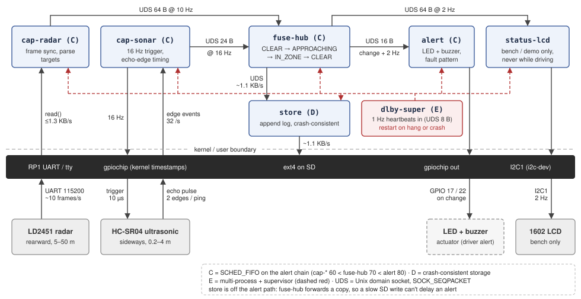

# Design document (M2) -- Don't Look Behind You (Jackson Stokes, Gage Boullosa)

Hardware and pin map: [docs/HARDWARE.md](docs/HARDWARE.md). Problem statement: [PROBLEM.md](PROBLEM.md).

## 1. Architecture

Seven processes on the Pi 5, all started and watched by `dlby-super`. Sensor data goes
straight to `fuse-hub`, which decides the alert state and forwards a copy to `store`.
Storage is deliberately off the alert path, so a slow SD write can never delay an alert.

| Process | Owner | Role | Scheduling |
|---|---|---|---|
| `dlby-super` | Jackson | starts, watches, restarts children | FIFO 90, mostly asleep |
| `cap-radar` | Gage | reads and parses radar frames | FIFO 60 |
| `cap-sonar` | Gage | 60 ms trigger, kernel-stamped echo edges | FIFO 60 |
| `fuse-hub` | Jackson | fusion state machine; own staleness timeout per sensor (radar 3 s, ultrasonic 8 pings, or EOF) | FIFO 70 |
| `alert` | Jackson | LED and buzzer patterns | FIFO 80 |
| `store` | Jackson | power-cut-safe append log | OTHER, nice +5 |
| `status-lcd` | Jackson | bench LCD, kept apart from `alert` | OTHER |

**IPC.** Every link is a Unix domain socket (UDS), `SOCK_SEQPACKET`. Receivers listen on
`/run/dlby/<name>.sock`. Senders reconnect with backoff (50 ms to 1 s) on EOF, `EPIPE`, or
a failed connect (`ECONNREFUSED`/`ENOENT` while the receiver restarts), so any process can
restart alone. `dlby-super` uses a socketpair per child for heartbeats only. We chose
seqpacket because it keeps message boundaries and reports a dead peer at once as EOF.

**Rates.** The diagram gives the payload and rate on every link. The busiest is
`fuse-hub` → `store` at ~1.1 KB/s (~4 MB/h, ~190 MB per 48 h soak). The radar UART carries
≤1.3 KB/s of its 11.5 KB/s capacity. To confirm on hardware: the ultrasonic rate is
16 Hz, because the HC-SR04 needs ≥60 ms between pings. The
radar message size (~64 B) is an estimate until the LD2451 frame format is checked.
Observed on the bench: with no targets the radar sends one empty frame every ~1.4 s, not
10 Hz ([docs/evidence/sensor-check.txt](docs/evidence/sensor-check.txt)); 10 Hz is assumed
only while it sees targets, unverified.

### Fusion states and driver signals
While both sensors are healthy, the radar alone raises the early APPROACHING warning (solid
LED) but IN_ZONE (buzzer) needs the ultrasonic to confirm the radar's track; if one is lost,
the survivor still warns in the degraded pattern. `fuse-hub` starts in BLIND, then moves
to the normal states once both sensors report, or to the matching DEG state if one reports
and the other stays silent past its loss timeout (radar 3 s, ultrasonic 8 pings).

An ultrasonic ping with no echo inside 4.3 m means "nothing in zone", and IN_ZONE needs
2 of the last 3 pings, so a single dropout doesn't flicker the alert. The buzzer has a
fixed tone, so its patterns differ only in timing. The bench LCD names a lost sensor.

| State | Meaning | LED | Buzzer |
|---|---|---|---|
| CLEAR | nothing near | 1 blink / 2 s | silent |
| APPROACHING | radar track | solid | silent |
| IN_ZONE | track confirmed | solid | 4 Hz beeps |
| DEG_CLEAR | one sensor lost | 2 blinks / 2 s | chirp on entry |
| DEG_APPROACHING | radar only | 1 Hz flash | silent |
| DEG_IN_ZONE | ultrasonic only | 1 Hz flash | 1 Hz beeps |
| BLIND | no sensors / hub starting | 4 Hz blink | 2 chirps, every 30 s |
| HUB_LOST (`alert`) | hub silent 1 s | 4 Hz blink | 2 chirps, every 30 s |
| nothing running | restart, boot, off | dark | silent |

BLIND and HUB_LOST both mean "not protected", so they share a pattern.

## 2. Mechanism mapping

### C: SCHED_FIFO on the alert chain (`cap-radar`, `cap-sonar`, `fuse-hub`, `alert`)
**Not the reason: range accuracy.** The kernel timestamps echo edges in the GPIO interrupt
path, so range = (t_fall − t_rise) × 343 m/s ÷ 2 doesn't depend on when `cap-sonar` runs.
Losing range data would take >250 ms of starvation to overflow the 16-event edge buffer.

**The reasons:**
1. **Alert latency under load.** A reading reaches the buzzer through three wakeups
   (capture, `fuse-hub`, `alert`). Under the default scheduler, with `store` flushing to
   the SD card, each can slip by milliseconds to tens of milliseconds. At 30 km/h closing
   speed, 50 ms is 0.4 m of a 4 m zone. Priority rises downstream (60 < 70 < 80) so each
   stage runs as soon as its input arrives.
2. **Regular trigger period.** A late wakeup stretches the gap between pings and adds to
   worst-case detection delay. Absolute deadlines (`clock_nanosleep`, `TIMER_ABSTIME`)
   stop lateness accumulating.
3. **Radar timestamps** are taken in user space on `read`, so they shift with scheduling
   delay, and fusion compares them against ultrasonic hits.

**Safety:** every real-time process calls `mlockall`. The RT throttle
(`sched_rt_runtime_us` = 950 ms/s) stays on, so a spinning child can't starve the system,
and `dlby-super` at priority 90 can still kill it.

### D: crash-consistent storage (`store`)
**Reason:** the ignition cuts power with no warning, many times a day, and this log is our
evidence for the evaluation (§6) and the 48 h soak. If a power cut could leave it garbled,
no result would be provable. So every record must be either complete and checkable, or
detectably incomplete and removed. `store` does this with append-only segments, a CRC on
every record, timed `fdatasync`, and truncation on boot (§4). It runs off the alert path,
so none of this can delay a warning.

### E: multi-process architecture with a supervisor
**Reason:** an outdoor sensor pod will fail in ordinary use (loose cable, water, a
locked-up ultrasonic). The driver must keep getting warnings from whatever still works and
must never read "LED dark" as "no cyclist". One process per job means one failure costs one
component, and the supervisor turns every failure into a visible state.

`dlby-super` starts the children in order (`store`, `fuse-hub`, `alert`, `status-lcd`,
`cap-radar`, `cap-sonar`). Each child inherits only its heartbeat socketpair, since every
fd is close-on-exec.
- **Crash:** SIGCHLD via `signalfd`, reaped with `waitpid(WNOHANG)`.
- **Hang:** each child sends a heartbeat every 1 s from its main event loop, never a side
  thread, so a stuck loop goes quiet. After 5 s of silence: SIGTERM, then SIGKILL 500 ms
  later. The first heartbeat is due within 10 s of start (CLAUDE.md allows 60 s).
- **Restart:** backoff 100 ms doubling to 30 s, reset after 60 s healthy; it never gives up
  on a sensor. Exit codes: 0 = stopped on request, no restart; 69 `EX_UNAVAILABLE` and
  70 `EX_SOFTWARE` = restart; 78 `EX_CONFIG` = log and don't restart.
- **Stuck outputs:** a killed `alert` can't release its GPIO lines safely, so super drives
  GPIO 17/22 low before restarting it.

Children set `PR_SET_PDEATHSIG` and exit on heartbeat-socket EOF, so none outlive super.
Super sends systemd `WATCHDOG=1` from its main loop, never a side thread, so a hung super
is caught (last row of §3).

## 3. Failure modes
Log lines have the form `<proc>[<pid>] <I|W|E> <event> key=value ...` on stderr, stored by
journald. Per-frame and per-ping events are never logged; repeats are limited to one line
per 10 s with a `count=` field.

| Component | Failure | Detection | Response | Log line |
|---|---|---|---|---|
| radar | dead or unplugged | no valid frame 3 s | DEG; ultrasonic alone | `fuse-hub[415] W degraded lost=radar` |
| ultrasonic | dead, unplugged, echo stuck high | no echo edge for 8 pings, or high > 60 ms | DEG; radar alone. Stuck-high needs power cycle | `cap-sonar[413] W sonar_lost reason=no_echo` |
| both sensors | lost together | both of the above | BLIND | `fuse-hub[415] E blind lost=radar,sonar` |
| `cap-*` process | crash or hang | hub staleness/EOF; super SIGCHLD/heartbeat | hub → DEG at once; super restarts; reconnect restores | `fuse-hub[415] W degraded lost=radar reason=stale` |
| `fuse-hub` | crash | super SIGCHLD; `alert` silent 1 s | HUB_LOST; restart into BLIND; senders retry on `ECONNREFUSED`/`ENOENT` | `dlby-super[400] E child_exit name=fuse-hub signal=SEGV` |
| `alert` | crash, outputs left on | super SIGCHLD | super forces GPIO 17/22 low, restarts | `dlby-super[400] I outputs_forced_off gpio=17,22` |
| any child | hang | no heartbeat 5 s | SIGTERM, SIGKILL after 500 ms, restart | `dlby-super[400] E heartbeat_lost name=store` |
| `store` | crash | super SIGCHLD; hub `EPIPE` | hub drops and counts records; `GAP` record on restart | `fuse-hub[415] I store_back dropped=37` |
| SD card | full | `ENOSPC` | delete oldest segment; journald capped (`SystemMaxUse=64M`); else state changes only | `store[417] E enospc_persist mode=state_only` |
| power | cut mid-write | next boot: bad CRC32 at tail | truncate to last good record; loss ≤ 1 s (`fdatasync` 1 s + on state change) | `store[417] W torn_tail truncated_bytes=41` |
| `dlby-super` | crash or hang | systemd: exit or no `WATCHDOG=1` 3 s; HW watchdog 15 s if systemd hangs | kill cgroup, outputs low, restart whole tree; dark LED = "not protected" | `systemd[1]: dlby.service: Watchdog timeout (limit 3s)!` |

Limits:
- A process stuck in uninterruptible I/O (D state) can't be killed; only a reboot recovers.
- A power cut can corrupt the SD card's controller; CRCs detect damage but can't prevent it.
- HC-SR04 stuck-high comes from clone-sensor reports, not yet seen on ours.
- Whether a released Pi 5 GPIO line holds its value is unverified; forcing it low sidesteps this.
- Single-sensor warnings add false alarms (parked cars, poles) to avoid going silent.

## 4. Storage and data

| Item | Design |
|---|---|
| What | every sensor message, every state change, a `GAP` record that `store` writes at every start (with the bytes recovery truncated), and a `GAP` message from `fuse-hub` (with its dropped count) when it reconnects after dropping records |
| Rate | ~1.3 KB/s (1.1 KB/s of messages plus record headers): ~4.8 MB/h, ~230 MB per 48 h soak |
| Format | append-only segments `/var/lib/dlby/log/seg-NNNNNN.log`. Each record has an 11-byte header, `len` u16, `type` u8, `seq` u32 (one counter for the whole log, continued across boots), `crc32` u32 over len + type + seq + payload, followed by the message exactly as received. Because messages are stored unchanged, the log is also the replay harness's input |
| Retention | 8 MB segments (~1.7 h), 512 MB cap (~4.5 days of driving); the oldest segment is deleted first. If the card is still full, state changes only |
| Durability | each record is a direct `write()`; `fdatasync` every 1 s and after each state change; `fsync` the directory after creating a segment |
| Power cut mid-write | loses ≤ ~1 s of samples, never a synced state change. On boot, truncate after the last record whose length and CRC check out; start a new segment with a `GAP` record |

ext4's journal keeps the file system consistent; the CRCs make our records trustworthy.

## 5. Constraints and substitutions
| Ideal | Actual | Cost |
|---|---|---|
| JSN-SR04T | HC-SR04 | not waterproof: bench only |
| radar proven on cyclists | LD2451, rated for cars | range unproven until ≥ 20 m test |
| PREEMPT_RT | stock Pi OS | non-preemptible kernel sections unbounded |
| car in traffic | empty lot, slow passes | low-speed claims only |
| live sensors | replay (Jackson is remote) | tests logic, not sensing |
| FIFO for range | FIFO for latency | claim narrowed (§2 C) |
| radar ~10 Hz | ~1.4 s per empty frame on bench | loss timeout raised to 3 s; a dead radar takes up to 3 s to show as DEG |

## 6. Evaluation plan

### C: does SCHED_FIFO bound alert latency?
Each test runs under SCHED_OTHER and SCHED_FIFO at three loads (idle; `stress-ng --cpu 4`;
`stress-ng --io 2 --vm 1` with `store` writing), ≥10,000 events per run.

| # | Measures | Method | Target (SCHED_FIFO) |
|---|---|---|---|
| C1 | Latency added between sensor event and alert GPIO edge | Messages carry their origin timestamp; the alert GPIO loops back to a spare input so the kernel stamps it on the same clock. Software-only variant: replayed input | p99 ≤ 2 ms, max ≤ 10 ms under load |

**C2, trigger jitter:** kernel timestamps of looped-back trigger edges; target std ≤ 100 µs,
longest gap ≤ 61 ms. **C3, range vs scheduling:** a static target at a taped distance under
load; mean and std should not change.

Sensor periods (60 ms, 100 ms) dominate end-to-end detection time and are reported
separately; C controls only the part scheduling adds.

### Domain, mechanism and soak tests
| Measurement | Method | Target |
|---|---|---|
| Radar range, cyclist | 5+ passes, hand-logged | ≥ 20 m (go/no-go) |
| Detection | ≥ 30 hand-logged passes | ≥ 90 % found; ≤ 1 false / 10 min |
| E restart | kill each child | ≤ 1 s to first message |
| D power cut | 50 cuts mid-write | 0 bad records kept; loss ≤ 1 s; `last_seq` = last kept, next = +1 |
| Fault injection | each §3 row once | matching §3 log line |
| 48 h soak | hourly CPU, RSS | no unexplained restarts; RSS +< 1 MB/process; CPU < 10 % |

## 7. Ownership map
| Owner | Owns |
|---|---|
| Jackson | `fuse-hub`, `store`, `dlby-super`, `alert`, `status-lcd`, replay harness, evaluation analysis, PROBLEM.md, DESIGN.md |
| Gage | `cap-radar`, `cap-sonar`, wiring and sensor pod, bench sketch, hardware tests, data capture |
| Shared | 48 h soak, demo, evaluation report |

## 8. AI-use plan
**We use AI for** planning and design review, explaining OS concepts, drafting code, test and
replay-data tools, and reviewing each other's PRs. **We don't use it for** anything at
runtime, accepting code we can't explain, weakening or deleting tests to make them pass, or
proposing hardware fixes without evidence (dmesg, timing captures, `/proc/interrupts`).

**Keeping the boundary visible:**
- Product code lives only in `src/`. Python and other tools live in `tools/` and are never
  deployed.
- `make check-boundary`, run by `make test`, fails if `src/` contains `AF_INET`/`AF_INET6`
  sockets, a `connect()` to anything but `AF_UNIX`, `getaddrinfo`, or an HTTP/curl library.
  It's a text check, so it can miss things; the next bullet is the real enforcement.
- The systemd unit sets `RestrictAddressFamilies=AF_UNIX` and `IPAddressDeny=any`, so the
  kernel blocks any network use at runtime, even if the code tried.
- AI session transcripts are committed to `docs/transcripts/` at the end of each milestone.
